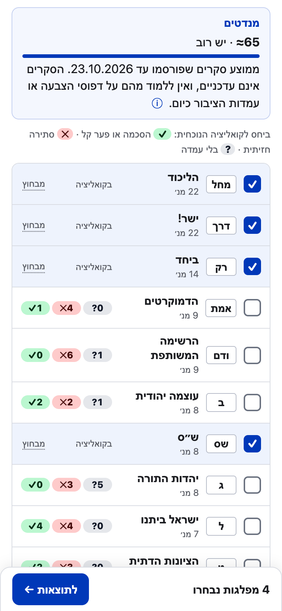
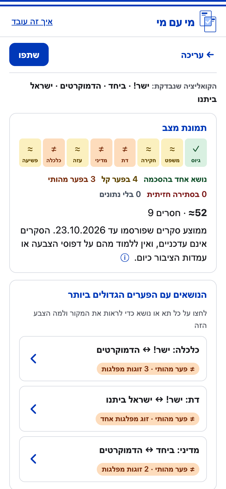
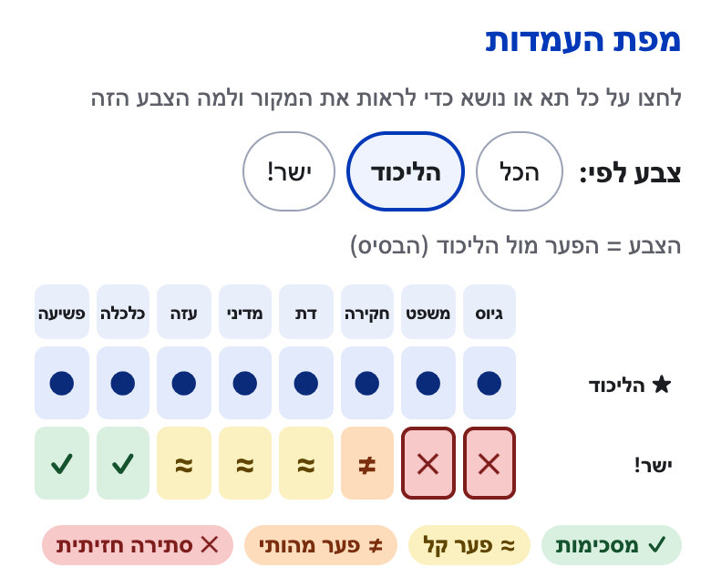
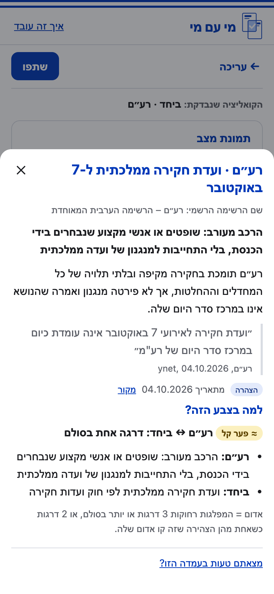
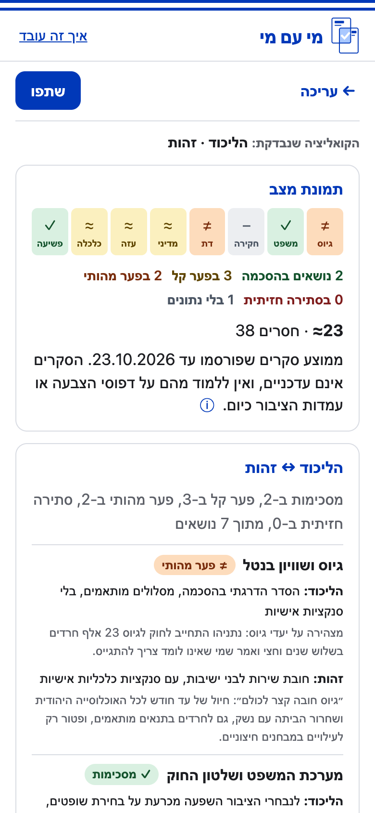
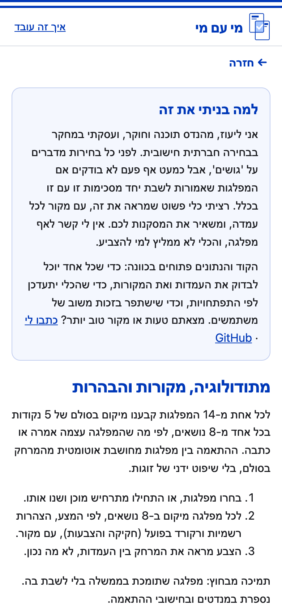

# מי עם מי

**בחרו מפלגות וגלו איפה הן מסכימות ואיפה הן מתנגשות.**

כלי ניטרלי לבחירות לכנסת ה-26 (27.10.2026): בוחרים מפלגות שעשויות לשבת יחד בקואליציה, ורואים באילו נושאים העמדות שלהן קרובות ובאילו הן רחוקות. כל עמדה מגובה במקור.

🔗 **האתר:** https://mi-im-mi-2026.netlify.app

> לא המלצת הצבעה. האתר עצמאי ואין לי קשר לאף מפלגה.

<table>
  <tr><td align="center" width="33%"><br><sub>בחירת מפלגות, וליד כל מפלגה מה היא מוסיפה לקואליציה</sub></td><td align="center" width="33%"><br><sub>תמונת מצב והנושאים עם הפערים הגדולים ביותר</sub></td><td align="center" width="33%"><br><sub>מפת העמדות, צבועה לפי הפער ממפלגת בסיס</sub></td></tr>
  <tr><td align="center" width="33%"><br><sub>מקור, ציטוט עם ייחוס, ולמה התא בצבע הזה</sub></td><td align="center" width="33%"><br><sub>השוואה בין שתי מפלגות, נושא אחרי נושא</sub></td><td align="center" width="33%"><br><sub>למה בניתי את זה, והמתודולוגיה</sub></td></tr>
</table>

## למה בניתי את זה

לפני כל בחירות מדברים על "גושים", אבל כמעט אף פעם לא בודקים אם המפלגות שאמורות לשבת יחד מסכימות זו עם זו בכלל. רציתי כלי פשוט שמראה את זה, עם מקור לכל עמדה, ומשאיר את המסקנות למשתמש. הרקע שלי הוא בהנדסת תוכנה ובמחקר בבחירה חברתית חישובית, ושאלת ההתאמה בין העדפות של שחקנים שונים היא בדיוק התחום הזה.

## איך זה עובד

- **14 מפלגות × 8 נושאים = 112 עמדות.** הנושאים: גיוס ושוויון בנטל · מערכת המשפט ושלטון החוק · ועדת חקירה ממלכתית ל-7 באוקטובר · דת, מדינה וזהות · הסוגיה הפלסטינית · ביטחון, עזה והיום שאחרי · כלכלה ויוקר המחיה · ביטחון אישי ופשיעה.
- **כל מפלגה ממוקמת על ציר של 5 דרגות בכל נושא,** רק לפי מה שהמפלגה עצמה אמרה, כתבה או עשתה:
  - **מצע** (59 עמדות)
  - **הצהרה רשמית** בלשון המפלגה או מנהיגה (30)
  - **רקורד בפועל**: הצעות חוק שהמפלגה יזמה או קידמה (7)
- **כשאין מקור שעומד בכללים, התא מסומן "אין עמדה מוצהרת"** (16 תאים). לא מנחשים.
- **ההתאמה מחושבת אוטומטית מהמרחק על הציר,** בלי שיפוט ידני של זוגות:

  | מרחק | רמה |
  |---|---|
  | 0 | מסכימות |
  | 1 | פער קל |
  | 2 | פער מהותי |
  | 3 ומעלה, או 2 כשאחת המפלגות הצהירה על קו אדום | סתירה חזיתית |

- **קו אדום** מסומן רק כשמפלגה אמרה במילים שלה שבלי הנושא היא לא תיכנס לממשלה (5 מקרים).
- **אין ציון כולל.** האתר מציג את הנושאים עם הפערים הגדולים ביותר, מה מאחד את הקואליציה, ואיזו מפלגה מייצרת הכי הרבה חיכוך.

המתודולוגיה המלאה, כולל כל התוויות של הצירים, כללי המקורות וטבלאות הכיסוי, נמצאת [באתר](https://mi-im-mi-2026.netlify.app/#method). נימוקי המיקום של כל עמדה וכל החלטות הבדיקה נמצאים ב-[`docs/research/`](docs/research/).

## ניטרליות ובדיקה

- **כללים מכניים במקום שיפוט:** סדר המפלגות לפי ממוצע הסקרים, חלוקה לגושים לפי מקור חיצוני (בקלפי וחדשות 12), שמות הרשימות לפי ועדת הבחירות המרכזית, וצבע אחד לכל המפלגות.
- **מילון מונחים ניטרלי לטקסט שלנו,** למשל "השינויים המוצעים במערכת המשפט" ו"החלת ריבונות / סיפוח". מונחים טעונים מופיעים רק בציטוט, עם ייחוס.
- **כל עמדה נבדקה על ידי סוכן בודק נפרד** מזה שכתב אותה, ואחר כך ידנית, בשתי נקודות בדיקה.
- **טעויות אמיתיות שנתפסו בדרך:**
  - ציטוט שיוחס בטעות למנהיג מפלגה. הוא תוקן לפי המקור.
  - סקריפט האנליטיקס המקורי שלח את הקואליציה של המשתמש, והוחלף בגרסה שלא שולחת אותה.
  - תג שהאחסון הוסיף בתחתית המסך הסתיר את ההסתייגות החוקית על הסקרים.
- **מספרי המנדטים** הם ממוצע סקרים שפורסמו עד 23.10.2026, ומוצגים עם ההסתייגות שנדרשת בחוק. ביום הבחירות עצמו הם יוסתרו בעזרת הדגל `showSeats` ב-`meta.json`, יחד עם כל מידע אחר שנגזר מהסקרים: המפלגות יסודרו לפי אותיות הפתק.

## פרטיות

אין עוגיות ואין משתמשים. הקואליציה נשמרת בכתובת. אם משתפים קישור, הבחירה מופיעה בו, ושרת האחסון רואה אותה כמו כל כתובת. אנחנו לא שומרים ולא מנתחים אותה. פירוט מלא נמצא בסעיף [פרטיות](https://mi-im-mi-2026.netlify.app/#privacy) באתר, ולידו [הצהרת הנגישות](https://mi-im-mi-2026.netlify.app/#accessibility) (ת״י 5568, ברמה AA), כולל מגבלות ידועות. מונה הכניסות ([GoatCounter](https://www.goatcounter.com)) פועל רק באתר עצמו, ומקבל רק את נתיב העמוד, הכותרת, רוחב המסך והדומיין שממנו הגיעו, בלי פרמטרי הקואליציה. בדיקת ה-smoke מוודאת את זה מול האתר, ומוודאת שמכל כתובת אחרת לא נשלח כלום.

## מצאתם טעות?

לכל תא באתר יש קישור "מצאתם טעות בעמדה הזו?". אפשר גם לכתוב ל-lioz.akirav@gmail.com או לפתוח [issue](https://github.com/Lioo7/mi-im-mi/issues) עם קישור למקור. הנתונים פתוחים בכוונה, כדי שכל אחד יוכל לבדוק אותם, ושהכלי יתעדכן וישתפר.

## איך זה נבנה

הפרויקט נבנה בפחות מיומיים, מרעיון ועד פרודקשן, עם דדליין קשיח: יום הבחירות.

- **תכנון:** גיבוש הרעיון, השיטה והצירים בשיחה עם Claude, כולל ביקורת על כל החלטה.
- **פיתוח:** [Claude Code](https://claude.com/claude-code), עם סוכני מחקר שרצו במקביל לפי נושאים, וסוכנים נפרדים לבדיקת המקורות.
- **בקרה אנושית:** אישור הצירים, בדיקת כל העמדות השנויות במחלוקת, ובדיקה בטלפון לפני כל פריסה.
- **בערך 40 קומיטים** בפחות מיממה, מהקומיט הראשון ועד הגרסה הסופית.

### הסטאק, ולמה

| בחירה | הסיבה |
|---|---|
| HTML, CSS ו-JavaScript (ES modules), בלי framework ובלי build | עמוד אחד עם כמה תצוגות. פחות מ-60KB דחוס, כולל כל הנתונים, נטען מהר בטלפון, ואין שלב בנייה שיכול להישבר ביום הבחירות |
| נתונים ב-JSON סטטי | אין שרת ואין מסד נתונים שיכולים ליפול. תיקון הוא עריכת קובץ ופריסה |
| Netlify | פריסה בפקודה אחת, CDN, וכתובות טיוטה לבדיקה לפני פרודקשן |
| `node --test` | 43 בדיקות לאלגוריתם ולנתונים, כולל בדיקת סימטריה: היפוך כיוון הציר חייב לתת תוצאה זהה |
| בדיקת smoke עם Chrome headless | צילומי מסך ב-390 וב-1280 פיקסלים, בדיקת שגיאות, בדיקה שההסתייגות על הסקרים גלויה ולא מוסתרת, ובדיקה שמונה הכניסות לא מקבל נתוני קואליציה |

### הרצה מקומית

```bash
python3 -m http.server -d site 8080   # האתר: http://localhost:8080
node --test                           # בדיקות
node scripts/validate.mjs             # אימות הנתונים
node scripts/smoke.mjs [baseUrl]      # בדיקת smoke עם צילומי מסך
```

שינויים בעמדות נעשים רק דרך `scripts/export-csv.mjs` ו-`scripts/import-csv.mjs`, שמאמת את הקובץ ומציג את ההבדלים.

### מבנה הנתונים

| קובץ | תוכן |
|---|---|
| [`site/data/parties.json`](site/data/parties.json) | 14 מפלגות: שם רשמי ושם מקוצר לפי ועדת הבחירות, אותיות הפתק, ממוצע סקרים, גוש, סטטוס מצע |
| [`site/data/topics.json`](site/data/topics.json) | 8 נושאים, ולכל אחד תוויות ל-5 הדרגות בציר |
| [`site/data/positions.json`](site/data/positions.json) | 112 עמדות: מיקום, קו אדום, סיכום, ציטוט וייחוס, מקור, סוג מקור, תאריך ועותק בארכיון |
| [`site/data/meta.json`](site/data/meta.json) | תאריכי עדכון, משפט ההסתייגות על הסקרים, קישורי המקורות ו-`showSeats` |
| [`docs/research/`](docs/research/) | יומן ההחלטות, הערות הראיות לכל עמדה, ותוצאות הבדיקות |

## רישיון

הקוד ברישיון [MIT](LICENSE). הנתונים שלנו (מיקומים, סיכומים ותוויות הצירים) ברישיון [CC BY 4.0](https://creativecommons.org/licenses/by/4.0/). הציטוטים והמקורות המקושרים שייכים לבעליהם.

נבנה על ידי ליעוז עקירב · [lioz.dev](https://lioz.dev) · [GitHub](https://github.com/Lioo7)

---

## English

**Mi Im Mi ("Who With Whom")** is a neutral, Hebrew, mobile-first web app for Israel's Knesset election of 27 October 2026. Pick parties that might form a coalition, and see where their positions agree and where they clash.

🔗 https://mi-im-mi-2026.netlify.app

<table>
  <tr><td align="center" width="33%"><br><sub>Pick parties; each row shows what it would add</sub></td><td align="center" width="33%"><br><sub>Status summary and the topics with the biggest gaps</sub></td><td align="center" width="33%"><br><sub>Position map, colored by distance from a base party</sub></td></tr>
  <tr><td align="center" width="33%"><br><sub>Source, attributed quote, and why the cell has its color</sub></td><td align="center" width="33%"><br><sub>Two parties compared, topic by topic</sub></td><td align="center" width="33%"><br><sub>Why I built this, and the method</sub></td></tr>
</table>

**Why.** Before every election, people talk about "blocs", but rarely check whether the parties expected to govern together actually agree with each other. I wanted a simple tool that shows this, with a source for every position, and leaves the conclusions to the user. My background is in software engineering and computational social choice research, which is exactly about aggregating and comparing preferences.

**Method.**
- **Coverage:** 14 parties × 8 topics = 112 positions.
- **Placement:** each party is placed on a 5-point axis per topic, using only its own platform (59), official statements (30) or legislative record: bills the party sponsored or advanced (7). Cells without a qualifying source say "no stated position" (16).
- **Scoring:** compatibility is computed from axis distance:
  - 0 = agree
  - 1 = minor gap
  - 2 = substantial gap
  - ≥3, or 2 when a party has declared a red line = head-on clash
- **No overall score:** there are no per-pair judgment calls and no single number.

**Neutrality and verification.**
- **Mechanical rules:** party order by poll average, blocs from an external source, and official list names.
- **Neutral wording:** a glossary for our own text. Loaded terms appear only in attributed quotes.
- **Verification:** every position was checked by a separate verifier agent and then reviewed by hand.
- **Real errors caught:**
  - a misattributed quote
  - an analytics script that leaked users' coalitions
  - a host badge covering the legally required poll disclaimer

**Privacy.** No cookies. The coalition is kept in the URL. A shared link contains it, and the host sees it like any URL; we don't store or analyze it. The page-view beacon runs only on the production site and sends only the path, page title, screen width and referrer origin. The smoke test checks this against the live site, and checks that nothing is sent from any other host. The site has a full [privacy section](https://mi-im-mi-2026.netlify.app/#privacy) and an [accessibility statement](https://mi-im-mi-2026.netlify.app/#accessibility) (Israeli standard IS 5568, WCAG 2.0 AA), including known limitations.

**How it was built.** In under two days, against a hard deadline (election day):
- planning with Claude
- implementation with Claude Code, with parallel research agents and independent source verifiers
- human checkpoints throughout
- about 40 commits

**Stack.** Static vanilla JS with no build step (<60KB gzipped including all data), JSON data, Netlify, `node --test` (43 tests, including mirror-symmetry tests: flipping the axis direction must give identical results), and a headless-Chrome smoke test that also checks that the page-view beacon carries no coalition data and that the poll disclaimer is visible.

**Corrections.** Every cell has a "found an error?" link. You can also email lioz.akirav@gmail.com or open an issue.

**License.** Code: MIT. Our data: CC BY 4.0. Quotes and linked sources belong to their owners. Not a voting recommendation; not affiliated with any party.

Built by Lioz Akirav · [lioz.dev](https://lioz.dev)
