# מי עם מי

**בנו קואליציה וגלו איפה המפלגות מסכימות ואיפה הן מתנגשות.**

כלי ניטרלי לבחירות לכנסת ה-26 (27.10.2026): בוחרים מפלגות שעשויות לשבת יחד בקואליציה, ורואים באילו נושאים העמדות שלהן קרובות ובאילו הן רחוקות. כל עמדה מגובה במקור.

**מאז 1.11: לפי תוצאות הבחירות.** מספרי המנדטים הם התוצאות הרשמיות של ועדת הבחירות המרכזית, שהוגשו לנשיא ב-4.11.2026. לכל מפלגה אפשר לסמן תפקיד (בקואליציה, תומכת מבחוץ או נמנעת, ומי שלא נבחרה מתנגדת), ולראות אם הממשלה הייתה זוכה באמון ומה חסר לחברות הקואליציה כדי להגיע ל-61. במקום התרחישים לפי גושים יש ארבעה תרחישים שעלו בתקשורת, כל אחד עם מקור ותאריך, וכשמפלגה בתרחיש הכחישה את הדיווח, גם ההכחשה ומקורה. העמדות עצמן מתועדות לפי ערב הבחירות.

🔗 **האתר:** https://mi-im-mi-2026.netlify.app · **באנגלית:** [mi-im-mi-2026.netlify.app/en/](https://mi-im-mi-2026.netlify.app/en/)

> לא המלצת הצבעה. האתר עצמאי ואין לי קשר לאף מפלגה.

<p align="center">
  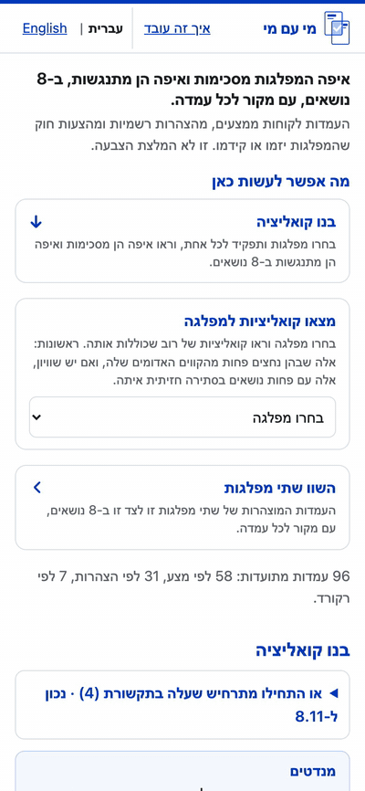
  <br><sub>הדגמה: מכרטיס בעמוד הבית בוחרים מפלגות ותפקיד לכל אחת, רואים את תמונת המצב, פותחים תא עם מקור, משווים בין שתי מפלגות ופותחים את המלצות הסיעות לנשיא.</sub>
  <br><sub>Demo: from a home card, pick parties and a role for each, see the summary, open a cell with its source, compare two parties, and open the parties' recommendations to the President.</sub>
</p>

<table>
  <tr><td align="center" width="33%">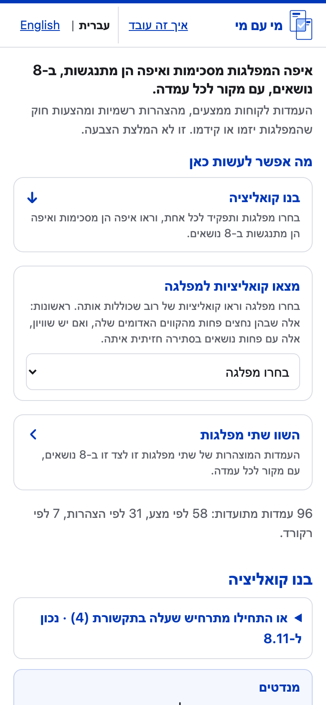<br><sub>עמוד הבית: שלושה דברים שאפשר לעשות כאן</sub></td><td align="center" width="33%">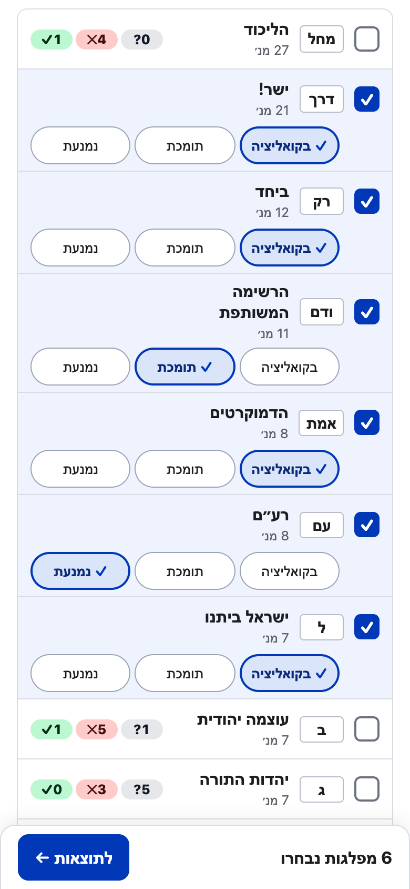<br><sub>בחירת מפלגות ותפקיד לכל אחת: בקואליציה, תומכת או נמנעת</sub></td><td align="center" width="33%">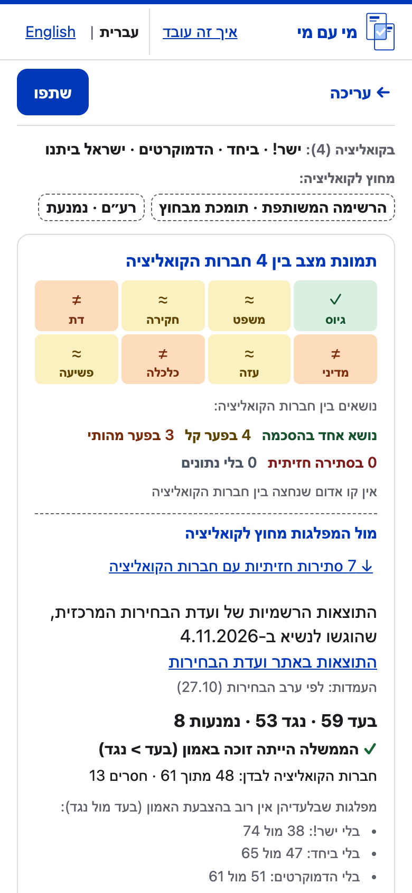<br><sub>תמונת מצב בין חברות הקואליציה, והמפלגות שמחוץ לה</sub></td></tr>
  <tr><td align="center" width="33%">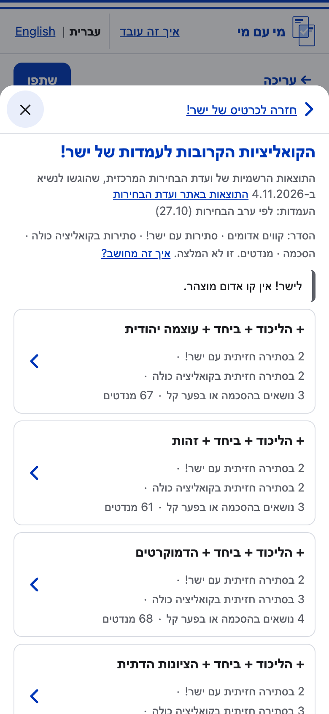<br><sub>הקואליציות הקרובות לעמדות של מפלגה, לפי סדר קבוע</sub></td><td align="center" width="33%">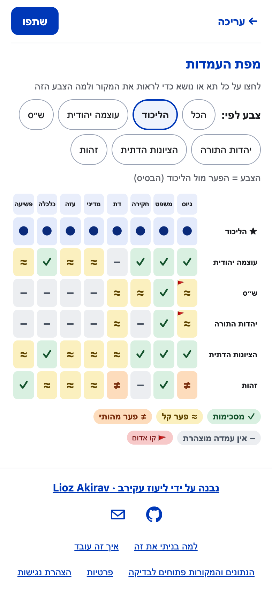<br><sub>מפת העמדות, צבועה לפי ההתנגשות החמורה ביותר בכל תא</sub></td><td align="center" width="33%">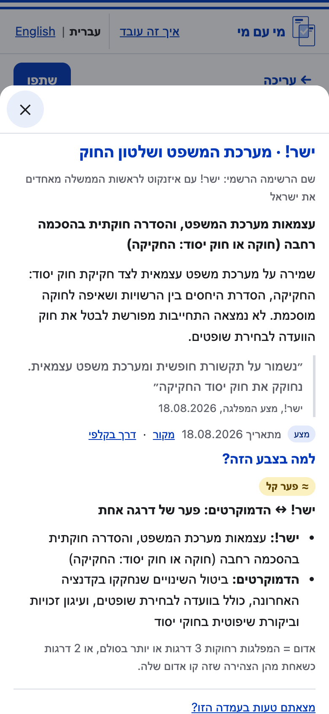<br><sub>מקור, ציטוט עם ייחוס, ולמה התא בצבע הזה</sub></td></tr>
  <tr><td align="center" width="33%">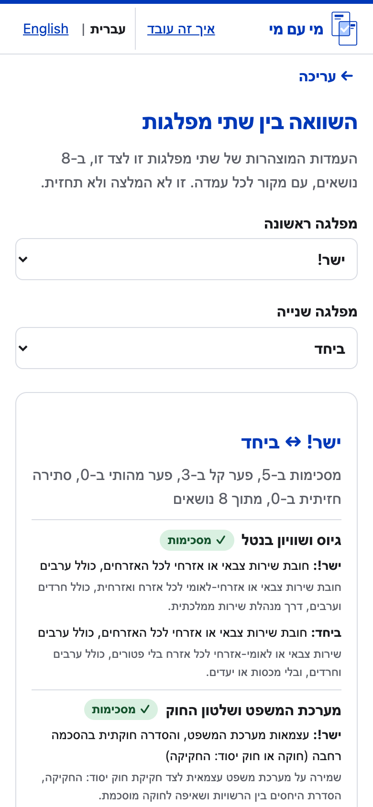<br><sub>השוואה בין שתי מפלגות, נושא אחרי נושא</sub></td><td align="center" width="33%">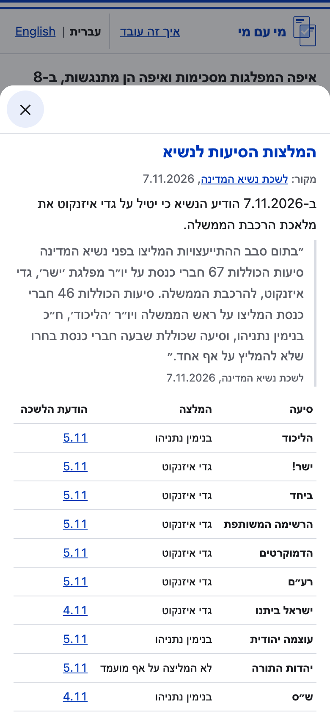<br><sub>המלצות הסיעות לנשיא, עם ההודעות של לשכת הנשיא</sub></td><td align="center" width="33%">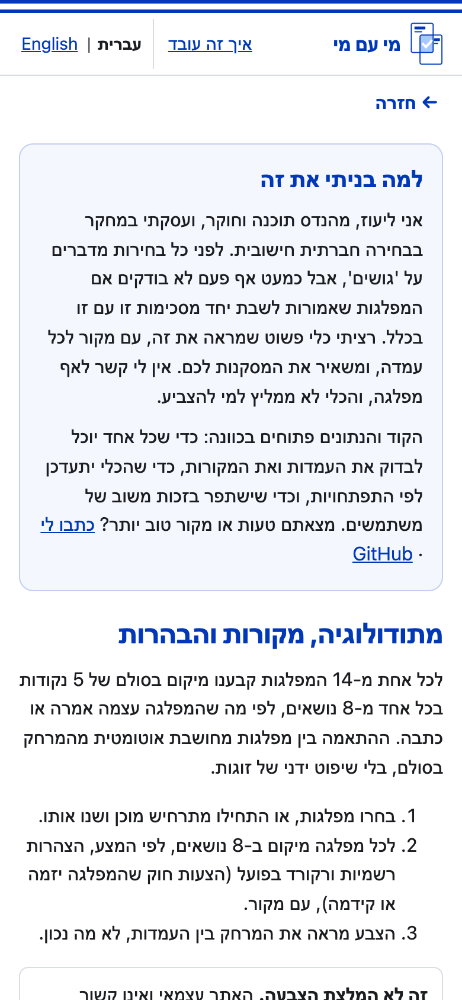<br><sub>למה בניתי את זה, והמתודולוגיה</sub></td></tr>
</table>

<table>
  <tr><td align="center" width="28%">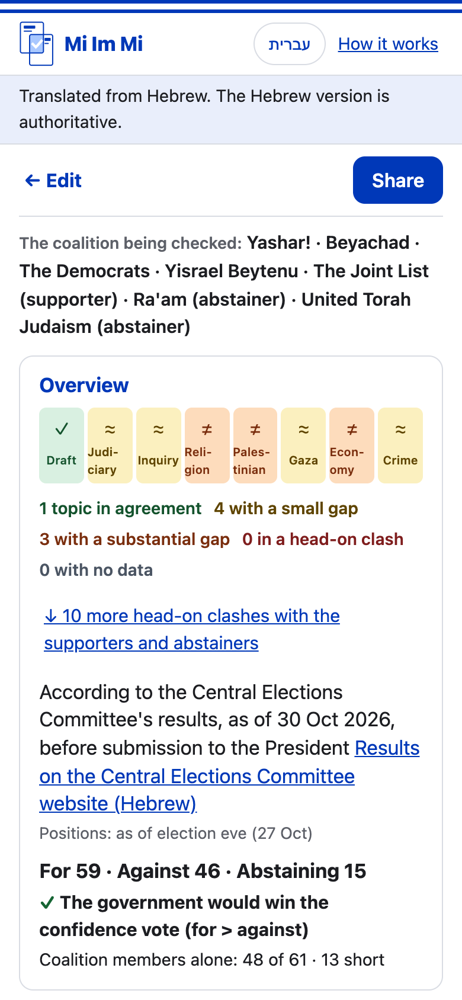<br><sub>הגרסה באנגלית, דרך <bdi>/en/</bdi>: אותה קואליציה ואותם מספרים, ושורה שהעברית היא הנוסח המחייב</sub></td><td align="center" width="72%">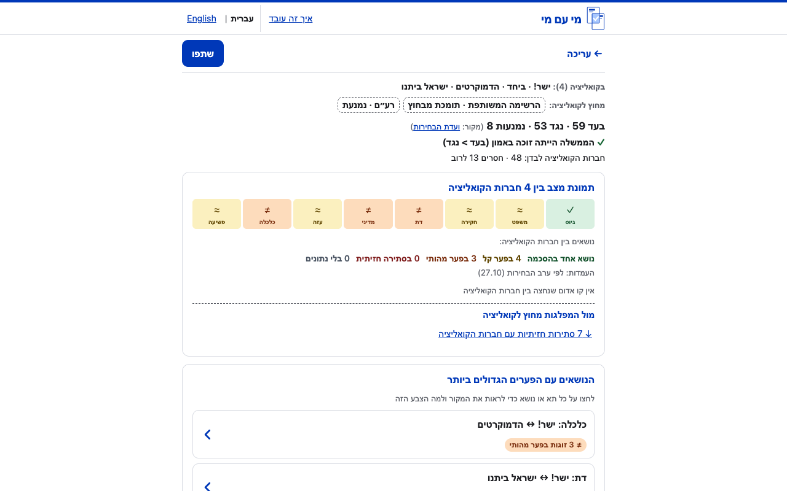<br><sub>תמונת המצב במסך מחשב, ברוחב 1280 פיקסלים</sub></td></tr>
</table>

## למה בניתי את זה

לפני כל בחירות מדברים על "גושים", אבל כמעט אף פעם לא בודקים אם המפלגות שאמורות לשבת יחד מסכימות זו עם זו בכלל. רציתי כלי פשוט שמראה את זה, עם מקור לכל עמדה, ומשאיר את המסקנות למשתמש. הרקע שלי הוא בהנדסת תוכנה ובמחקר בבחירה חברתית חישובית, ושאלת ההתאמה בין העדפות של שחקנים שונים היא בדיוק התחום הזה.

## איך זה עובד

- **14 מפלגות × 8 נושאים = 112 עמדות.** הנושאים: גיוס ושוויון בנטל · מערכת המשפט ושלטון החוק · ועדת חקירה ממלכתית ל-7 באוקטובר · דת, מדינה וזהות · הסוגיה הפלסטינית · ביטחון, עזה והיום שאחרי · כלכלה ויוקר המחיה · ביטחון אישי ופשיעה.
- **כל מפלגה ממוקמת על ציר של 5 דרגות בכל נושא,** רק לפי מה שהמפלגה עצמה אמרה, כתבה או עשתה:
  - **מצע** (59 עמדות)
  - **הצהרה רשמית** בלשון המפלגה או מנהיגה (30)
  - **רקורד בפועל**: הצעות חוק שהמפלגה יזמה או קידמה (7)
- **כשאין מקור שעומד בכללים, התא מסומן "אין עמדה מוצהרת"** (16 תאים). לא מנחשים. כשנמצאו דברים שאינם עמדה על הציר, הם מוצגים עם המקור, בלי למקם את העמדה.
- **ההתאמה מחושבת אוטומטית מהמרחק על הציר,** בלי שיפוט ידני של זוגות:

  | מרחק | רמה |
  |---|---|
  | 0 | מסכימות |
  | 1 | פער קל |
  | 2 | פער מהותי |
  | 3 ומעלה, או 2 כשאחת המפלגות הצהירה על קו אדום | סתירה חזיתית |

- **קו אדום** מסומן רק כשמפלגה אמרה במילים שלה שבלי הנושא היא לא תיכנס לממשלה (5 מקרים). בתמונת המצב שורה אחת מונה את הקווים האדומים שנחצים בתוך הקואליציה (קו אדום של חברה, כשחברה אחרת רחוקה ממנה 2 דרגות או יותר), או אומרת שאין כאלה.
- **אין ציון כולל.** האתר מציג את הנושאים עם הפערים הגדולים ביותר, מה מאחד את הקואליציה, ואיזו מפלגה מייצרת הכי הרבה חיכוך.
- **תפקידים והצבעת אמון:** ההתנגשויות נבדקות רק בין חברות הקואליציה, והפערים של תומכות ונמנעות מוצגים בנפרד. אחרי הבחירות הציונות הדתית וזהות נבחרות ונספרות בנפרד. בעד = חברות הקואליציה והתומכות, נגד = כל השאר חוץ מהנמנעות, והממשלה זוכה באמון כשבעד > נגד. מעבר של חברי כנסת בודדים לא מחושב. מתחת להצבעה מופיעות המפלגות שהתוצאה תלויה בכל אחת מהן לבדה: בלעדיה אין לחברות הקואליציה 61, או שאין רוב באמון (נמנעת נבדקת כאילו הצביעה נגד), עם המספרים בלעדיה בלבד. טקסט השיתוף מוסיף, כשיש תומכות או נמנעות, את מספר הסתירות החזיתיות שלהן מול חברות הקואליציה (אותו מספר כמו בתמונת המצב).
- **מה חסר לרוב של 61:** הצירופים הקטנים ביותר של מפלגות נוספות שמביאים את חברות הקואליציה לבדן ל-61. קודם צירופים עם הכי מעט מפלגות, ואז לפי מספר המנדטים שנוספים. לכל צירוף: כמה נושאים בסתירה חזיתית וכמה מהם חדשים, ואילו קווים אדומים הוא חוצה לראשונה. מידע, לא המלצה.
- **הקואליציות הקרובות לעמדות של מפלגה:** בכרטיס של כל מפלגה שעברה את אחוז החסימה, ובבחירת מפלגה במסך הבנייה. אלה הקואליציות המינימליות של 61 שכוללות אותה, לפי סדר קבוע בלי משקלות: קווים אדומים שלה שנחצים, נושאים בסתירה חזיתית איתה, נושאים בסתירה חזיתית בקואליציה כולה, נושאים בהסכמה או בפער קל, ואז מנדטים. קואליציות עם שותפה שאין לה עמדה ב-3 נושאים או יותר מוצגות בנפרד, רק בלחיצה, עם אזהרה. מידע, לא המלצה.
- **מה אפשר לעשות כאן:** בעמוד הבית שלושה כרטיסים: בניית קואליציה, מציאת הקואליציות למפלגה, והשוואה בין שתי מפלגות.
- **המלצות הסיעות לנשיא:** לכל סיעה בכנסת, את מי המליצה ומתי, עם קישור להודעה של לשכת הנשיא, והספירה שפרסמה הלשכה ב-7.11, כלשונה.
- **הורדה ויומן שינויים:** כל 112 העמדות להורדה, ב-CSV וב-JSON, ורשימה ציבורית של שינויים בנתונים שמבקר באתר יבחין בהם, בעמוד "איך זה עובד".

המתודולוגיה המלאה, כולל כל התוויות של הצירים, כללי המקורות וטבלאות הכיסוי, נמצאת [באתר](https://mi-im-mi-2026.netlify.app/#method). נימוקי המיקום של כל עמדה וכל החלטות הבדיקה נמצאים ב-[`docs/research/`](docs/research/).

## ניטרליות ובדיקה

- **כללים מכניים במקום שיפוט:** סדר המפלגות לפי מספר המנדטים בתוצאות (לפני הבחירות: לפי ממוצע הסקרים), חלוקה לגושים לפי מקור חיצוני (בקלפי וחדשות 12), שמות הרשימות לפי ועדת הבחירות המרכזית, וצבע אחד לכל המפלגות.
- **מילון מונחים ניטרלי לטקסט שלנו,** למשל "השינויים המוצעים במערכת המשפט" ו"החלת ריבונות / סיפוח". מונחים טעונים מופיעים רק בציטוט, עם ייחוס.
- **כל עמדה נבדקה על ידי סוכן בודק נפרד** מזה שכתב אותה, ואחר כך ידנית, בשתי נקודות בדיקה.
- **טעויות אמיתיות שנתפסו בדרך:**
  - ציטוט שיוחס בטעות למנהיג מפלגה. הוא תוקן לפי המקור.
  - סקריפט האנליטיקס המקורי שלח את הקואליציה של המשתמש, והוחלף בגרסה שלא שולחת אותה.
  - תג שהאחסון הוסיף בתחתית המסך הסתיר את ההסתייגות החוקית על הסקרים.
- **מספרי המנדטים** הם התוצאות של ועדת הבחירות המרכזית, כפי שפורסמו (בלי חישוב מחדש, כי הסכמי עודפים משנים את החלוקה), והמפלגות מסודרות לפי מספר המנדטים. ממוצע הסקרים מלפני הבחירות נשמר בנתונים: אם יהיו בחירות חוזרות, החזרה למצב סקרים היא שינוי של שורה אחת (`mode` ב-`meta.json`), ואז הסקרים מוצגים עם ההסתייגות שנדרשת בחוק.

## עברית ואנגלית

- **האתר זמין גם באנגלית.** בקצה הסרגל העליון מופיעות שתי השפות, "עברית | English": השפה הנוכחית מודגשת, ולחיצה על השנייה מחליפה שפה במקום, בלי לאבד את הקואליציה או את התצוגה. השפה נשמרת בכתובת (`l=en`, אחרי הסימן #), כך שקישור משותף נפתח באותה שפה. העברית היא הנוסח המחייב, וכל עמוד באנגלית אומר את זה בשורה קטנה מתחת לסרגל העליון.
- **מה תורגם:** כל הטקסט של האתר, הנושאים ותוויות הצירים, 112 התקצירים, ו-95 ציטוטים שאינם באנגלית. הציטוט עצמו נשאר בשפת המקור, ומתחתיו תרגום שמסומן כתרגום של האתר. השם הרשמי של הרשימה מוצג בעברית, כלשונו, ואחריו תרגום.
- **איך זה נבדק:** תרגום ← בדיקה עיוורת ← ייבוא. סוכן בודק נפרד תרגם את האנגלית בחזרה לעברית בלי לראות את המקור, ורק אחר כך השווה למקור: נאמנות, מילון המונחים, ניטרליות, תוויות הצירים ושמות. 8 מתוך 373 פריטים סומנו, וכולם תוקנו. התרגומים נכנסים לנתונים דרך ה-CSV, כמו כל שינוי בעמדות.
- **שמות באנגלית:** לפי רשימת לשכת העיתונות הממשלתית באנגלית או האנגלית של המפלגה עצמה, ואחרת תעתיק. שם עברי מתועתק (Beyachad, Yashar!), אלא אם יש לו שם מקובל באנגלית (Religious Zionism). אותיות הפתק נשארות בעברית.
- **מילון המונחים עובר גם לאנגלית:** "Judea and Samaria / the West Bank", "applying sovereignty / annexation", ו-"Haredi (ultra-Orthodox)" בהופעה הראשונה. בדיקה אוטומטית אוכפת את המילון בשתי השפות.
- **קישורים באנגלית:** קישור שיתוף באנגלית עובר דרך `/en/`, ולכן התצוגה המקדימה שלו (למשל בוואטסאפ) באנגלית. העמוד מעביר מיד לאתר באנגלית, עם אותה קואליציה ([#21](https://github.com/Lioo7/mi-im-mi/issues/21)).

## פרטיות

אין עוגיות ואין משתמשים. הקואליציה נשמרת רק בכתובת שבדפדפן, אחרי הסימן #, ולכן לא נשלחת לשרת. כשמשתפים קישור, הבחירה מופיעה בו. קישור בפורמט הישן, שבו הקואליציה מופיעה אחרי סימן שאלה, מגיע לשרת פעם אחת כשפותחים אותו, ומיד מומר לפורמט החדש, לפני שהדף טוען נתונים. אנחנו לא שומרים ולא מנתחים את הבחירה. פירוט מלא נמצא בסעיף [פרטיות](https://mi-im-mi-2026.netlify.app/#privacy) באתר, ולידו [הצהרת הנגישות](https://mi-im-mi-2026.netlify.app/#accessibility) (ת״י 5568, ברמה AA), כולל מגבלות ידועות. מונה הכניסות ([GoatCounter](https://www.goatcounter.com)) פועל רק באתר עצמו, ומקבל רק את נתיב העמוד, הכותרת, רוחב המסך והדומיין שממנו הגיעו, בלי פרמטרי הקואליציה. בדיקת ה-smoke מוודאת את זה מול האתר, ומוודאת שמכל כתובת אחרת לא נשלח כלום.

## מצאתם טעות?

לכל תא באתר יש קישור "מצאתם טעות בעמדה הזו?". אפשר גם לכתוב ל-lioz.akirav@gmail.com או למלא את [הטופס לדיווח על טעות](https://github.com/Lioo7/mi-im-mi/issues/new?template=data-correction.yml) עם קישור למקור. הנתונים פתוחים בכוונה, כדי שכל אחד יוכל לבדוק אותם, ושהכלי יתעדכן וישתפר.

## איך זה נבנה

הפרויקט נבנה בפחות מיומיים, מרעיון ועד פרודקשן, עם דדליין קשיח: יום הבחירות.

- **תכנון:** גיבוש הרעיון, השיטה והצירים בשיחה עם Claude, כולל ביקורת על כל החלטה.
- **פיתוח:** [Claude Code](https://claude.com/claude-code), עם סוכני מחקר שרצו במקביל לפי נושאים, וסוכנים נפרדים לבדיקת המקורות.
- **בקרה אנושית:** אישור הצירים, בדיקת כל העמדות השנויות במחלוקת, ובדיקה בטלפון לפני כל פריסה.
- **בערך 40 קומיטים** בפחות מיממה, מהקומיט הראשון ועד הגרסה הסופית.

### הסטאק, ולמה

| בחירה | הסיבה |
|---|---|
| HTML, CSS ו-JavaScript (ES modules), בלי framework ובלי build | עמוד אחד עם כמה תצוגות. כ-130KB דחוס בטעינה הראשונה, כולל כל הנתונים, נטען מהר בטלפון, ואין שלב בנייה שיכול להישבר ביום הבחירות |
| נתונים ב-JSON סטטי | אין שרת ואין מסד נתונים שיכולים ליפול. תיקון הוא עריכת קובץ ופריסה |
| Netlify | פריסה בפקודה אחת, CDN, וכתובות טיוטה לבדיקה לפני פרודקשן |
| `node --test` | 150 בדיקות לאלגוריתם ולנתונים, כולל בדיקת סימטריה (היפוך כיוון הציר חייב לתת תוצאה זהה), בדיקה שהמנדטים מסתכמים ב-120, בדיקה מול חיפוש ממצה של הצירופים ל-61 ושל הקואליציות הקרובות למפלגה, בדיקות לשתי השפות, ובדיקה שאין נקודה-פסיק בטקסט העברי |
| שתי שפות בלי ספרייה | `strings.js` ו-`strings.en.js` באותו מבנה, ושדות `en` ליד העברית בנתונים. בדיקה נכשלת אם חסר תרגום לאחת המחרוזות, `validate.mjs` נכשל אם חסר תרגום בנתונים, ובדיקת מילון מונחים רצה על שתי השפות |
| בדיקת smoke עם Chrome headless | צילומי מסך ב-390 וב-1280 פיקסלים, בדיקת שגיאות, בדיקה ששורת המקור של המנדטים גלויה לפני המספרים (בתצוגת התוצאות: שורת ועדת הבחירות, ובתצוגת סקרים: ההסתייגות שנדרשת בחוק), בדיקה שמונה הכניסות לא מקבל נתוני קואליציה ושאף בקשה לשרת לא נושאת אותה, ובדיקה שמדיניות האבטחה (CSP) לא חוסמת כלום ושהאחסון לא מוסיף לדף סקריפט (התג של Netlify כבוי). כל התצוגות נבדקות גם באנגלית: כיוון ושפה, שאין טקסט עברי שלא תורגם, ואותם מספרים |

### הרצה מקומית

```bash
python3 -m http.server -d site 8080   # האתר: http://localhost:8080
node --test                           # בדיקות
node scripts/validate.mjs             # אימות הנתונים
node scripts/smoke.mjs --mode=all     # בדיקת smoke בשלושת המצבים במקביל (צילומי מסך עם --shots)
node scripts/smoke.mjs --only=pair    # רק חלק אחד, בזמן תיקון
npm run media                         # צילומי המסך וההדגמה של ה-README, מחדש
```

שינויים בעמדות נעשים רק דרך `scripts/export-csv.mjs` ו-`scripts/import-csv.mjs`, שמאמת את הקובץ ומציג את ההבדלים.

### מבנה הנתונים

| קובץ | תוכן |
|---|---|
| [`site/data/parties.json`](site/data/parties.json) | 14 מפלגות: שם רשמי ושם מקוצר לפי ועדת הבחירות, אותיות הפתק, ממוצע סקרים, גוש, סטטוס מצע |
| [`site/data/topics.json`](site/data/topics.json) | 8 נושאים, ולכל אחד תוויות ל-5 הדרגות בציר, בעברית ובאנגלית (`en`) |
| [`site/data/positions.json`](site/data/positions.json) | 112 עמדות: מיקום, קו אדום, סיכום (גם באנגלית), ציטוט וייחוס ותרגום הציטוט לאנגלית, מקור, סוג מקור, תאריך ועותק בארכיון |
| [`site/data/meta.json`](site/data/meta.json) | תאריכי עדכון, `mode` (תוצאות או סקרים), סטטוס התוצאות, משפט ההסתייגות על הסקרים, קישורי המקורות ו-`showSeats` |
| [`site/data/scenarios.json`](site/data/scenarios.json) | עד 4 תרחישים שעלו בתקשורת: חברות, תומכות ונמנעות, ומקור עם תאריך לכל אחד |
| [`site/data/recommendations.json`](site/data/recommendations.json) | המלצות הסיעות לנשיא (#4): המלצה אחת לכל רשימה בכנסת, הטלת התפקיד והספירה של הלשכה, וקישורים להודעות ב-president.gov.il |
| [`site/data/results-26.json`](site/data/results-26.json) | תוצאות ועדת הבחירות לכל רשימה: קולות, אחוזים ומנדטים, כפי שפורסמו (התוצאות הרשמיות, שהוגשו לנשיא ב-4.11.2026) |
| [`docs/research/`](docs/research/) | יומן ההחלטות, הערות הראיות לכל עמדה, ותוצאות הבדיקות |

## רישיון

הקוד ברישיון [MIT](LICENSE). הנתונים שלנו (מיקומים, סיכומים ותוויות הצירים) ברישיון [CC BY 4.0](https://creativecommons.org/licenses/by/4.0/). הציטוטים והמקורות המקושרים שייכים לבעליהם.

נבנה על ידי ליעוז עקירב · [lioz.dev](https://lioz.dev) · [GitHub](https://github.com/Lioo7)

---

## English

**Build a coalition and see where the parties agree and where they clash.**

**Mi Im Mi ("Who With Whom")** is a neutral, mobile-first web app, in Hebrew with an English version, for Israel's Knesset election of 27 October 2026. Pick parties that might form a coalition, and see where their positions agree and where they clash.

**Since 1 November it runs on the results:** seats from the Central Elections Committee's official results, submitted to the President on 4 November 2026. Each party can be marked as a member, an outside supporter or an abstainer (everyone else votes against). The app shows whether the government would win the investiture vote (for > against) and which single parties that result or the members' 61 depends on (the numbers without each; an abstainer is checked as voting against), which red lines are crossed within the coalition (one line in the summary, also when there are none), the smallest sets of extra parties that would give the members alone 61 seats (fewest parties first, with the new head-on clashes and newly crossed red lines of each), the minimal 61-seat coalitions closest to one party's stated positions (a fixed order with no weights: its own red lines crossed, its head-on clashes, head-on clashes in the whole coalition, agreement, seats; coalitions with a partner silent on 3+ topics are listed apart, on request, with a warning), and how far supporters and abstainers are from the coalition (their head-on clashes are also counted in the share text). Four scenarios raised in the media (each with its source and date, and a party's denial with its source when there is one, named by composition only) replace the bloc presets. Positions are as documented on election eve.

**Also on the site.**
- **What you can do here:** three cards on the home page: build a coalition, find the coalitions for a party, compare two parties.
- **Recommendations to the President:** whom each Knesset faction recommended and when, linked to the President's Office announcement, and the tally the Office published on 7 November, verbatim.
- **Download and changelog:** all 112 positions as CSV and JSON, and a public list of the data changes a visitor would notice, on the About page.

🔗 https://mi-im-mi-2026.netlify.app · in English: [mi-im-mi-2026.netlify.app/en/](https://mi-im-mi-2026.netlify.app/en/)

<table>
  <tr><td align="center" width="33%"><br><sub>Home: three things you can do here</sub></td><td align="center" width="33%"><br><sub>Pick parties and a role for each: member, supporter or abstainer</sub></td><td align="center" width="33%"><br><sub>Summary between the coalition members, and the parties outside it</sub></td></tr>
  <tr><td align="center" width="33%"><br><sub>The coalitions closest to one party's positions, in a fixed order</sub></td><td align="center" width="33%"><br><sub>Position map, each cell colored by its most severe clash</sub></td><td align="center" width="33%"><br><sub>Source, attributed quote, and why the cell has its color</sub></td></tr>
  <tr><td align="center" width="33%"><br><sub>Two parties compared, topic by topic</sub></td><td align="center" width="33%"><br><sub>The parties' recommendations to the President, with the President's Office announcements</sub></td><td align="center" width="33%"><br><sub>Why I built this, and the method</sub></td></tr>
</table>

<table>
  <tr><td align="center" width="28%"><br><sub>The English version, via /en/: the same coalition and numbers, with a line saying the Hebrew is authoritative</sub></td><td align="center" width="72%"><br><sub>The summary on a desktop screen, 1280px wide</sub></td></tr>
</table>

**English version.**
- **Language switch:** both languages at the end of the top bar ("English | עברית"), the current one in bold; tapping the other switches in place, keeping the coalition and the view. The language is kept in the URL fragment (`l=en`), so a shared link opens in the same language. The Hebrew is authoritative, and every English page says so in a small line under the header.
- **Translated:** all UI text, the topics and axis labels, the 112 summaries and the 95 quotes not already in English. A quote stays in its original language, with the site's translation under it, marked as such. The official list name is shown verbatim in Hebrew, followed by a translation.
- **Checked:** translate → blind back-translation → import. An independent reviewer translated the English back into Hebrew without seeing the original, and only then compared (fidelity, glossary, neutrality, axis labels, names). 8 of 373 items were flagged; all were fixed. Translations enter the data through the same CSV import as every position change.
- **Names:** from the Government Press Office's English list or the party's own English, otherwise transliterated. A Hebrew party name is transliterated (Beyachad, Yashar!) unless it has an established English name (Religious Zionism). Ballot letters stay in Hebrew.
- **Glossary:** "Judea and Samaria / the West Bank", "applying sovereignty / annexation", and "Haredi (ultra-Orthodox)" on first use; a test enforces the glossary in both languages.
- **English links:** an English share link goes through `/en/`, so its preview (e.g. on WhatsApp) is in English; the page then opens the English site with the same coalition ([#21](https://github.com/Lioo7/mi-im-mi/issues/21)).

**Why.** Before every election, people talk about "blocs", but rarely check whether the parties expected to govern together actually agree with each other. I wanted a simple tool that shows this, with a source for every position, and leaves the conclusions to the user. My background is in software engineering and computational social choice research, which is exactly about aggregating and comparing preferences.

**Method.**
- **Coverage:** 14 parties × 8 topics = 112 positions.
- **Placement:** each party is placed on a 5-point axis per topic, using only its own platform (59), official statements (30) or legislative record: bills the party sponsored or advanced (7). Cells without a qualifying source say "no stated position" (16).
- **Scoring:** compatibility is computed from axis distance:
  - 0 = agree
  - 1 = minor gap
  - 2 = substantial gap
  - ≥3, or 2 when a party has declared a red line = head-on clash
- **No overall score:** there are no per-pair judgment calls and no single number.

**Neutrality and verification.**
- **Mechanical rules:** party order by seats won (before the election: by poll average), blocs from an external source, and official list names.
- **Neutral wording:** a glossary for our own text. Loaded terms appear only in attributed quotes.
- **Verification:** every position was checked by a separate verifier agent and then reviewed by hand.
- **Real errors caught:**
  - a misattributed quote
  - an analytics script that leaked users' coalitions
  - a host badge covering the legally required poll disclaimer

**Privacy.** No cookies. The coalition is kept only in the URL fragment (after `#`), which browsers never send to the server. A shared link contains it. An old-format link, with the coalition after `?`, reaches the server once when opened and is rewritten to the new format right away, before the page loads any data. We don't store or analyze the coalition. The page-view beacon runs only on the production site and sends only the path, page title, screen width and referrer origin. The smoke test checks this against the live site, and checks that nothing is sent from any other host. The site has a full [privacy section](https://mi-im-mi-2026.netlify.app/#privacy) and an [accessibility statement](https://mi-im-mi-2026.netlify.app/#accessibility) (Israeli standard IS 5568, WCAG 2.0 AA), including known limitations.

**How it was built.** In under two days, against a hard deadline (election day):
- planning with Claude
- implementation with Claude Code, with parallel research agents and independent source verifiers
- human checkpoints throughout
- about 40 commits

**Stack.** Static vanilla JS with no build step (about 130KB gzipped on first load, including all data), JSON data, Netlify, `node --test` (150 tests, including mirror-symmetry tests, a 120-seat check, brute-force checks of the completions to 61 and of the closest coalitions to a party, a test that fails on any missing translation, a glossary test for both languages, a test that keeps semicolons out of the Hebrew text, and a code scan that every seat-bearing string is gated), bilingual with no i18n library (two string files with the same shape, `en` fields next to the Hebrew data), a full Content-Security-Policy, and a headless-Chrome smoke test that also checks that the page-view beacon and every request to the site carry no coalition data, that the CSP blocks nothing and the host injects no script (Netlify's badge is off), and that the line explaining the seat numbers comes before them: the results source line in results mode, the legally required poll disclaimer in polls mode. Every view is also checked in English: direction and language, no untranslated Hebrew, and the same numbers.

**Testing.** `node --test` (unit), `node scripts/validate.mjs` (data), and `node scripts/smoke.mjs [url]`, a headless-Chrome run of every view in both languages:
- `--only=<sections>`: just the parts a change touches (a wrong name lists them)
- `--mode=results|polls|hidden|all`: one data mode, or all three in parallel (the local server overrides `meta.json`)
- `--light`: the check against a deploy: every file served byte for byte, every header, the views at phone width
- `--shots`: save screenshots (none by default)

README media: `npm run media` (`scripts/readme-media.mjs [url]`) recaptures the screenshots and the demo GIF the same way every run (needs ffmpeg for the GIF).

The loop:
1. While working: only the relevant sections, in their mode.
2. Before a draft: the full suite once (`--mode=all`, about 2 min).
3. Draft deploy, `--light` against the draft URL, then a check on a phone.
4. Publish that same tested draft (`netlify api restoreSiteDeploy`), then `--light` against production.

Before → after ([#37](https://github.com/Lioo7/mi-im-mi/issues/37)), every assertion kept: all three modes 13 min → 2 min, the check against a draft 6.5 min → 23 s, a small fix from request to draft URL ~20 min → ~3 min.

**Corrections.** Every cell has a "found an error?" link. You can also email lioz.akirav@gmail.com or use the [data-correction form](https://github.com/Lioo7/mi-im-mi/issues/new?template=data-correction.yml).

**License.** Code: MIT. Our data: CC BY 4.0. Quotes and linked sources belong to their owners. Not a voting recommendation; not affiliated with any party.

Built by Lioz Akirav · [lioz.dev](https://lioz.dev)
